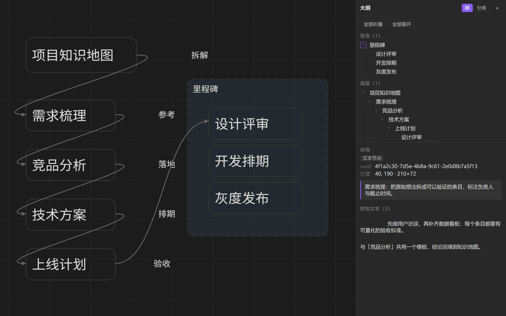
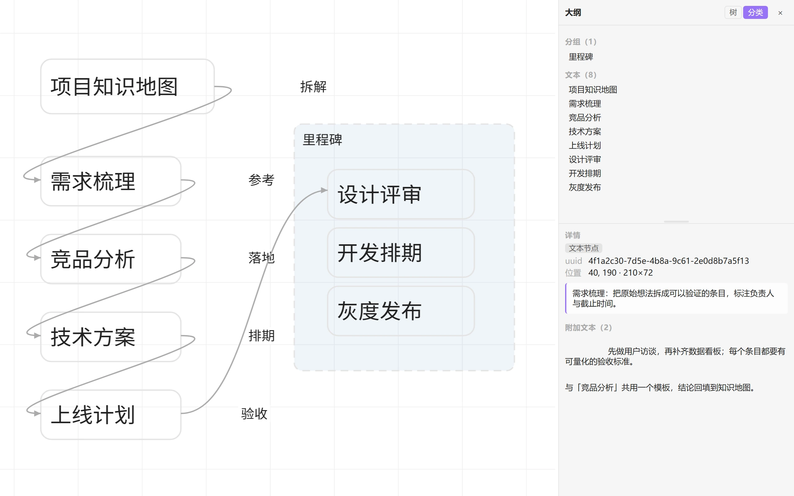

# Project Graph Viewer

A read-only Obsidian plugin that renders Project Graph `.prg` canvases — nodes, edges, images, LaTeX and sections.

在 Obsidian 中直接打开 [Project Graph](https://graphif.dev) 的 `.prg` 画布文件：节点、连线、图片、
LaTeX 公式与分组框都会按原作者排版渲染，并支持平移、缩放、搜索、大纲与深链。

> 只读查看器：不会修改 `.prg` 文件。编辑请回到 Project Graph。
>
> 非官方插件，与 Project Graph 作者无关联；仅支持 Obsidian 桌面端（`isDesktopOnly`）。

## 演示

打开 `.prg` 是一个独立的只读预览标签页：左侧画布支持滚轮缩放、拖动平移与适配视图，右侧大纲与详情
面板各自滚动，互不挤占：



大纲有「树 / 分类」两种视图。树按层级来源分成 `包含` 与 `连接` 两组，分类按节点类型平铺；两者都跟随
Obsidian 的明暗主题（下图为浅色主题 + 分类视图）：



## 功能

- 在文件列表双击 `.prg`，显示为独立的只读预览标签页；命令面板、文件右键菜单与工具条也能打开。
- 画布：拖动平移、滚轮缩放（`Ctrl/⌘ + 滚轮` 平移，可在设置中互换）、双击节点聚焦、点击空白取消选择。
- 搜索框实时定位节点（`Enter` 循环跳转）。
- 右侧大纲支持「树 / 分类」两种视图。树按层级来源分成 `包含`（分组框嵌套）与 `连接`（连线方向）两组，
  同一分组框可以在两组里各出现一次；分组框的折叠角标带方框与强调色，可折叠任意分支，点击即定位（同时
  是无障碍入口）；大纲默认宽度、详情默认高度与默认视图都可在设置中调整。
- 画布与大纲共用方向键导航：上下切换节点，左右在父级 / 子级间移动。
- 详情面板区分「节点自身文本」与「附加文本」，显示 uuid、位置与图片预览；详情固定在侧栏下方独立滚动。
- 图片附件（`attachments/`）与 LaTeX 公式（KaTeX MathML，离线可用）。
- 跟随 Obsidian 主题（浅色 / 深色），可开启网格背景。
- 每个文件记住缩放与位置（写入插件目录的 `reading-state.json`，不修改 `.prg` 文件）。
- 深链：复制 `prg://` 文件 / 节点 / 视野链接，或在 Project Graph 中打开。

渲染的对象类型：

- `TextNode`
- `ImageNode`
- `LatexNode`
- `Section`
- `LineEdge`（含自环）

其余类型（`PenStroke`、`SvgNode`、`UrlNode`、`MediaNode`、`ReferenceBlockNode` 与未来版本的未知类型）
显示为占位框，保留位置与类型名。

## 安装

### 从 Obsidian 社区插件安装

社区目录收录后，可在 **设置 → 第三方插件 → 浏览** 中搜索 **Project Graph Viewer**，安装并启用。
收录前请使用下面的手动安装。

### 手动安装

1. 从本仓库的 [Releases](../../releases) 下载 `project-graph-viewer.zip`；也可以分别下载
   `main.js`、`manifest.json`、`styles.css`。
2. 在库的配置目录中创建插件文件夹 `<库>/.obsidian/plugins/project-graph-viewer/`，把压缩包里的三个文件
   解压到该目录（三个文件必须直接位于插件文件夹内）。
3. 重新加载 Obsidian，在 **设置 → 第三方插件** 中启用 **Project Graph Viewer**。

> 插件文件夹必须命名为 `project-graph-viewer`，与 `manifest.json` 的 `id` 一致。使用自定义配置目录时按实际路径放置。
> 本插件为桌面端插件（`isDesktopOnly: true`），移动端无法安装。

从源码构建并安装到测试库的步骤见 [docs/development.md](docs/development.md)。

## 使用

| 操作             | 说明                                      |
| ---------------- | ----------------------------------------- |
| 拖动             | 平移画布                                  |
| 滚轮             | 缩放（默认；可在设置中改为平移）          |
| `Ctrl/⌘ + 滚轮`  | 平移（默认；可在设置中改为缩放）          |
| 双击节点         | 聚焦该节点                                |
| `+` / `-`        | 放大 / 缩小                               |
| `0`              | 重置为 100%                               |
| `F`              | 适配全部内容                              |
| `/`              | 聚焦搜索框                                |
| `Esc`            | 取消选择                                  |
| 方向键           | 切换选中节点（左右：父级 / 第一个子节点） |
| `Shift + 方向键` | 平移画布                                  |

设置 → Project Graph Viewer 可切换：滚轮操作（缩放/平移互换）、背景网格、默认展开大纲、大纲视图
（节点树/按类型）、大纲默认宽度、详情默认高度、按文件记忆视图、图片缓存上限、调试日志。滚轮缩放以
光标为锚点。

工具条：适配、放大、缩小、100%、搜索、大纲、复制深链、在 Project Graph 中打开、重新加载。

大纲：标题栏的「树 / 分类」切换两种视图。节点树中点击箭头折叠/展开分支，也可用「全部折叠 / 全部展开」；
在画布或大纲中按方向键可切换选中节点，大纲中左右键在父级/子级间移动，遇到折叠的分支会先展开或折叠它。
选中节点时，大纲会自动展开它所在的分支并高亮对应条目。大纲与详情分上下两个独立滚动区，详情固定在下方，
不会随节点列表滚走。

宽度与详情高度：设置页的「大纲默认宽度 / 详情默认高度」决定每次打开 `.prg` 时的初始布局；打开后拖动
大纲左侧边缘或详情分隔条只影响当前会话，双击分隔条恢复设置中的默认高度。拖动不会写入 `data.json`，
下次打开文件仍按设置页的值展示。

### 配置与阅读状态

插件目录（`<库>/.obsidian/plugins/project-graph-viewer/`）下有两个文件：

| 文件                 | 内容                     | 写入时机                     |
| -------------------- | ------------------------ | ---------------------------- |
| `data.json`          | 插件设置                 | 仅在修改设置时               |
| `reading-state.json` | 每个 `.prg` 的缩放与位置 | 打开、平移、缩放之后（防抖） |

`.prg` 文件本身始终只读。若库用 Git 管理，可以只忽略阅读状态，让设置仍可被追踪：

```gitignore
.obsidian/plugins/project-graph-viewer/reading-state.json
```

（使用自定义配置目录时按实际路径调整。）旧版本把阅读状态存在 `data.json` 的 `cameras` 字段里；升级后
首次加载会自动迁移，`data.json` 只会变化这一次。

### 深链

复制得到的链接形如：

```
prg:///path/to/vault/map.prg?target=<uuid>
```

Windows 盘符路径会写成 `prg:///C:/notes/map.prg?target=<uuid>`；路径中的空格与中文会做 URL 编码。
链接可粘贴到任意笔记中，点击后由 Project Graph 打开对应文件并定位节点。`prg://` 仅桌面端可用。

### 命令

- `Project Graph Viewer: 打开 Project Graph 文件…`
- `Project Graph Viewer: 在 Project Graph 中打开`
- `Project Graph Viewer: 复制 prg:// 链接`
- `Project Graph Viewer: 复制选中节点的 prg:// 链接`
- `Project Graph Viewer: 适配视图` / `放大` / `缩小` / `重置为 100%`
- `Project Graph Viewer: 切换大纲侧栏`
- `Project Graph Viewer: 重新加载 .prg`

## 支持范围与已知限制

- 已完整支持：`TextNode`、`ImageNode`、`LatexNode`、`Section`、`LineEdge`（含自环）
- 占位显示（保留位置与类型名）：`PenStroke`、`SvgNode`、`UrlNode`、`MediaNode`、`ReferenceBlockNode`、
  以及未来版本的未知节点类型
- 多目标连线仅显示首尾两个端点
- 连线标签字号为 20 世界单位（Project Graph 内部按边宽推导，差异较大时以官方为准）
- 只读：不提供编辑、连线操作或回写
- 详见 [docs/compatibility.md](docs/compatibility.md)

## 开发

从源码构建、安装到测试库、测试与检查命令见 [docs/development.md](docs/development.md)；目录结构、
分层约束与提交规范见 [CONTRIBUTING.md](CONTRIBUTING.md)；发版流程见 [docs/releasing.md](docs/releasing.md)。

## 版本

版本号以 [manifest.json](manifest.json) 为准；每个版本的变更见 [CHANGELOG.md](CHANGELOG.md)，
发版与分支规范见 [docs/releasing.md](docs/releasing.md)。

## 许可与致谢

本项目以 MIT 许可发布。PRG 格式与视觉约定的来源说明见 [NOTICE](NOTICE)：

- [Project Graph](https://graphif.dev)（GPL-3.0）—— 格式规范与视觉约定
- [fflate](https://github.com/101arrowz/fflate)（MIT）—— ZIP 解压
- [@msgpack/msgpack](https://github.com/msgpack/msgpack-javascript)（ISC）—— MessagePack
- [KaTeX](https://katex.org)（MIT）—— LaTeX → MathML
