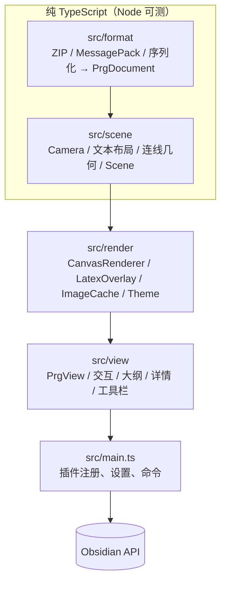

# 架构

## 分层



依赖只允许自上而下。`test/purity.test.ts` 会扫描 `src/format`、`src/scene`、`src/util`，禁止出现
`import "obsidian"` 或直接的 DOM 创建调用。

## 数据流

```
vault.readBinary(file)
  → readZipEntries(bytes, limits)          // 大小/路径校验，内存解压
  → decodeMsgpack(stage.msgpack)
  → resolveReferences(root)                // "_" 类名 + "$" 指针
  → parsePrg(...)                          // 归一化为 PrgDocument（含 warnings）
  → buildScene(document)                   // 分组排序、折叠隐藏、连线几何、包围盒
  → Camera + CanvasRenderer + LatexOverlay // 每帧绘制
  → DOM
```

右侧大纲由 `src/view/outline-panel.ts` 渲染，树模式按层级来源分成两组森林：

- `包含`：`buildContainmentTree` 只按 `Section.children` 建树，不在其他框内的框是根，框内实体按作者顺序挂在下面。
- `连接`：`buildEdgeTree` 只按 `LineEdge` 的 `from → to` 建树，每个节点/框至多一个入边父级；没有入边者为根
  （只有出边的框也是根），同级按画布位置排序。首个声明生效、成环链接被忽略，包含关系不参与。

`buildOutlineGroups` 把两份森林命名为「包含」「连接」；分类模式仍由 `groupForOutline` 按节点类型平铺。
同一个节点/框可以在两组各出现一次，`flattenOutline` 用 `组名:节点id` 作为行键，方向键导航与焦点恢复都按
行键处理。`PrgView` 持有当前模式、折叠集合、侧栏宽度与详情高度；模式与默认布局来自设置，视图打开时把
默认宽度/详情高度复制到会话字段，之后拖动只改会话字段（不写 `data.json`）。画布与大纲共用
`flattenOutline` 与 `resolveOutlineNavigation` 纯函数实现方向键导航：画布走完整先序，大纲走可见行并在
左右键时折叠/展开分支；两者都只影响侧栏与选择，不触碰 `.prg` 或阅读状态文件。侧栏分为上下两个独立滚动区
（大纲 + 详情），详情区初始高度由设置决定并自行滚动；拖动中间的分隔条只改变当前会话的详情高度（双击恢复
设置默认值），因此节点再多或详情再长也不会互相挤占。

## 视图生命周期

1. `onOpen`：构建工具栏/画布/侧栏，创建渲染器、LaTeX 浮层、图片缓存、交互控制器与 `ResizeObserver`。
2. `onLoadFile`：读取并解析；成功后按设置恢复相机或 `fit`；刷新大纲、详情、元信息。
3. 文件被外部修改（`vault.modify`）时 400ms 防抖重载；删除时展示错误卡。
4. `onUnloadFile` / `onClose`：取消动画帧、断开观察器、释放图片与 LaTeX 元素。

`onOpen` 与 `onLoadFile` 的调用顺序在不同 Obsidian 版本/工作区恢复场景下可能互换，
因此 `onLoadFile` 在 DOM 尚未就绪时只设置 `pendingLoad`，由 `onOpen` 补一次加载。

## 坐标系与渲染

- 相机：`screen = (world - offset) * scale`；缩放以光标为锚点，范围 `0.05 – 8`。
- 画布：`devicePixelRatio` 缩放，世界坐标直接作为绘制坐标；线宽/圆角按世界单位。
- 每帧只绘制视口内对象（矩形相交 + 边包围盒），文本布局按节点缓存。
- 选中轮廓线宽 `2 / scale`，保证屏幕上恒为 2px；悬停轮廓为半透明 1px。
- 文本节点遵循 Project Graph 的规则：字号 `32 * 2^(fontScaleLevel/2)`、内边距 `字号/32*14`、
  边框 `字号/32*2`、圆角 16、行高 1.5、`manual` 模式下按宽度折行；文本块在节点内**垂直居中**，
  文字高于节点时从顶部内边距开始溢出。
- 缩放很小时（屏幕字号 < 12px），透明节点会叠加一层主题边框色 20% 的填充，避免缩略视图里节点"消失"。
- 滚轮行为可配置：默认滚轮缩放、`Ctrl/⌘ + 滚轮` 平移；设置中可互换（`resolveWheelAction` 纯函数负责判定）。
- LaTeX 节点不进入画布，由 HTML 浮层用 KaTeX MathML 渲染并按相机缩放字号（矢量清晰、无需字体资源）。

## 错误处理

- 所有解析失败收敛为 `PrgError { code, message, details }`，由视图渲染错误卡（可重试/外部打开）。
- 可恢复问题进入 `PrgWarning[]`：未知类型、失效引用、重复 uuid、缺失附件、版本过新等；
  未知类型绘制占位框，不中断其余内容。
- 容器安全：条目数 ≤ 1000、单文件 ≤ 200 MiB、总计 ≤ 500 MiB，解压前用 filter 拦截；
  拒绝绝对路径、盘符与 `..`；附件 UUID 冲突视为损坏文件。

## 性能

- 视口裁剪 + 文本布局缓存 + 脏标记 + `requestAnimationFrame` 合并重绘。
- 图片走 `ImageBitmap` LRU（默认 64 MiB，可配置），淘汰时 `close()` 释放显存/内存。
- 缩放小于 6px 字号时不绘制节点文字（与官方阈值行为一致）。
- 构建产物约 620 KiB，其中 KaTeX 占大头；它换来了离线、无字体依赖的公式渲染。

## 状态持久化

设置与阅读状态分开保存在插件目录（`<配置目录>/plugins/project-graph-viewer/`），不触碰 vault 笔记或 `.prg` 文件：

| 文件                 | 内容                   | 写入时机                           |
| -------------------- | ---------------------- | ---------------------------------- |
| `data.json`          | 设置项（`settings`）   | 仅在用户修改设置时                 |
| `reading-state.json` | 每个 `.prg` 的相机状态 | 打开 / 平移 / 缩放后（500ms 防抖） |

```json
// data.json
{
  "settings": {
    "background": "none",
    "outlineMode": "tree",
    "outlineWidth": 260,
    "detailsRatio": 0.4,
    "rememberCameraPerFile": true,
    "maxImageCacheMB": 64
  }
}
```

`outlineWidth` / `detailsRatio` 是**打开文件时使用的默认布局**，只在设置页修改时写入 `data.json`。
打开文件后拖动分隔条只改变该视图实例的会话状态，不写盘；下次打开仍按设置值展示。

```json
// reading-state.json
{
  "version": 1,
  "cameras": { "notes/example.prg": { "x": -1200, "y": -800, "scale": 0.4 } }
}
```

- 路径键排序、2 空格缩进、末尾换行；内容未变化时不写盘，连续缩放只落一次盘。
- 旧版本把 `cameras` 写在 `data.json`：加载时与 `reading-state.json` 合并（后者优先），新文件写入成功后
  才把 `data.json` 重写为仅含 `settings`，因此升级只会产生一次 `data.json` 变更。
- `reading-state.json` 缺失或损坏时按空状态处理；写入失败只退化为“不记忆视图”，不影响阅读。
- `rememberCameraPerFile` 关闭时不写入阅读状态。
- 建议把 `.obsidian/plugins/project-graph-viewer/reading-state.json` 加入库仓库的 `.gitignore`：阅读状态变化频繁，
  而设置仍可被版本管理追踪。

## 测试边界

- 纯层（format/scene/util）由 Node 单测覆盖，覆盖率门槛强制。
- 渲染层只测试纯函数（主题映射、颜色解析）；画布与 DOM 交互靠手工冒烟清单。
- 真实文件回归通过 `pnpm inspect` 的类计数对照完成，见 `docs/compatibility.md`。
